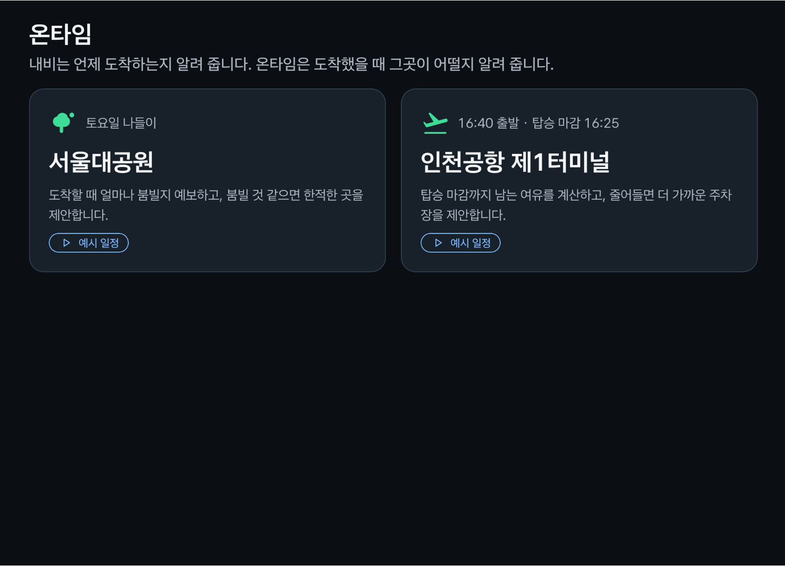
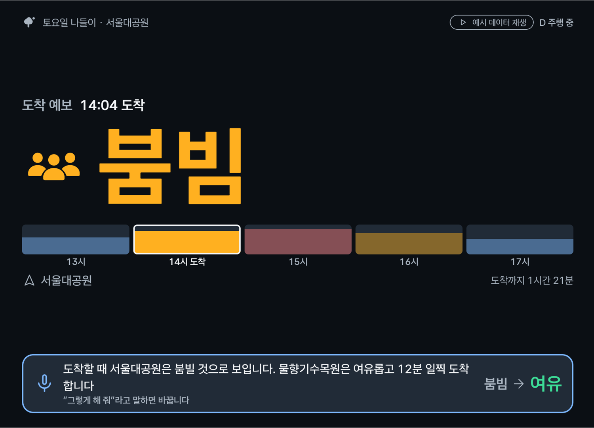
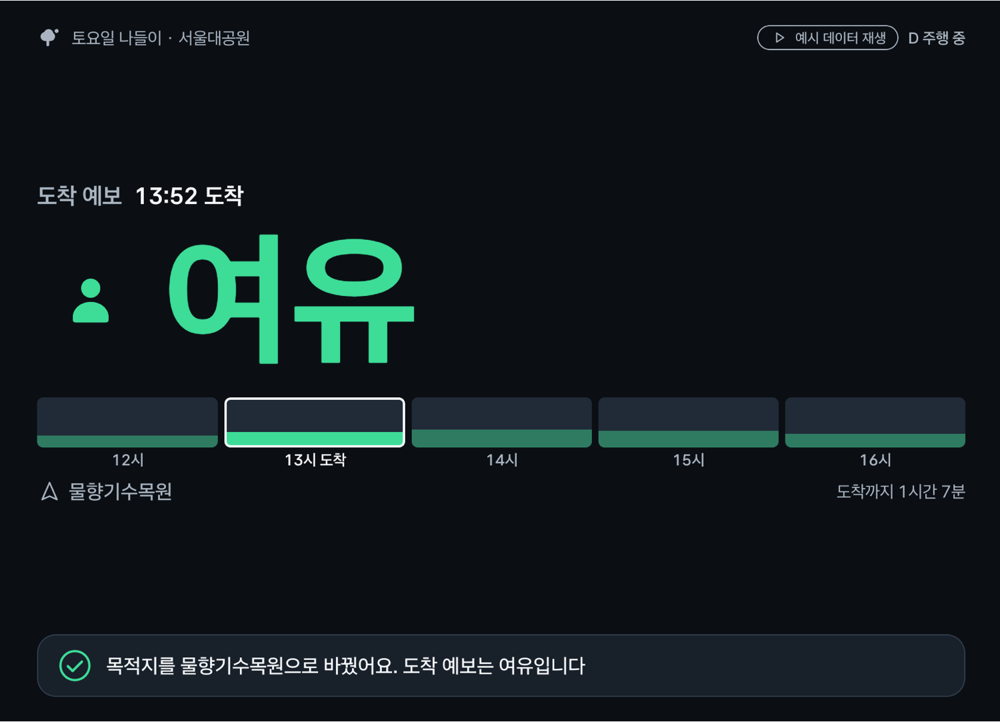
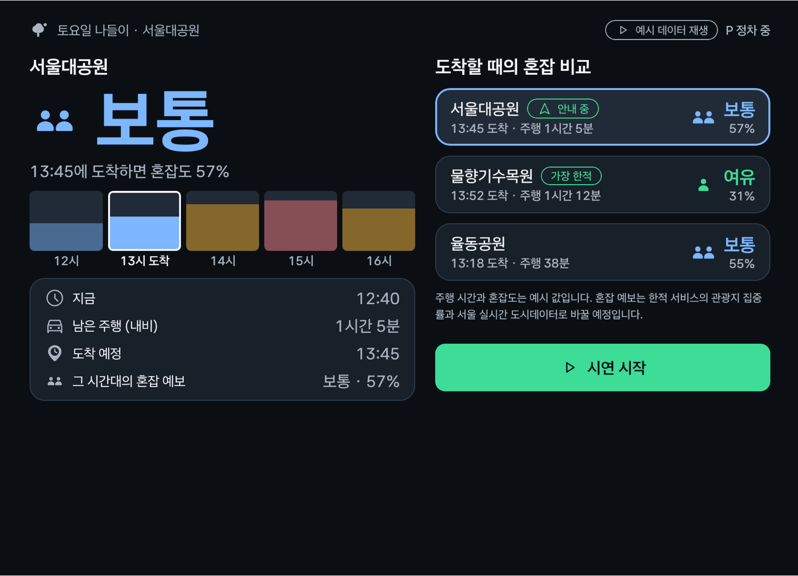
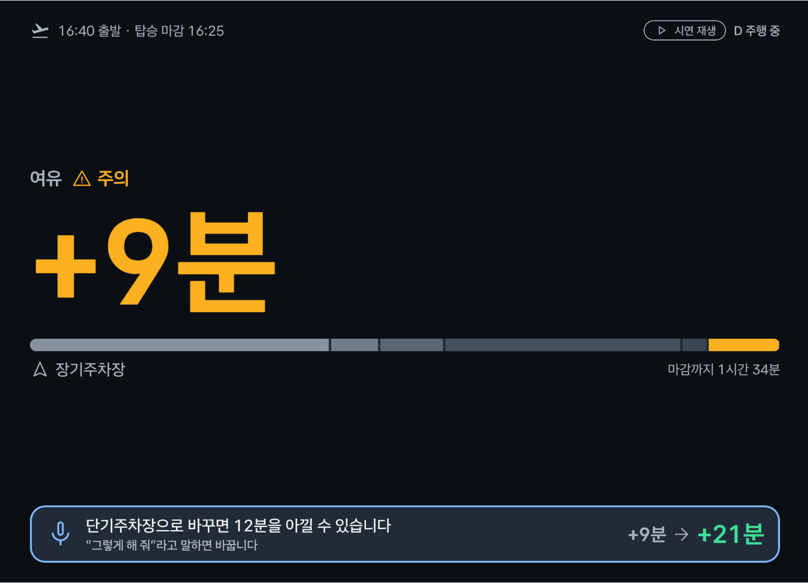
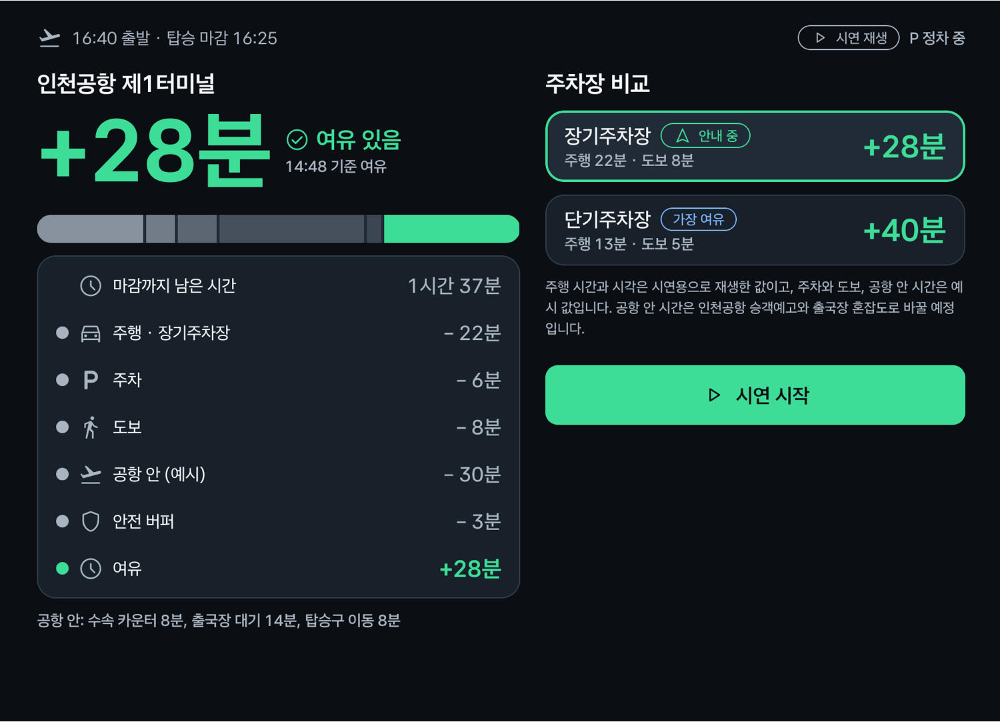
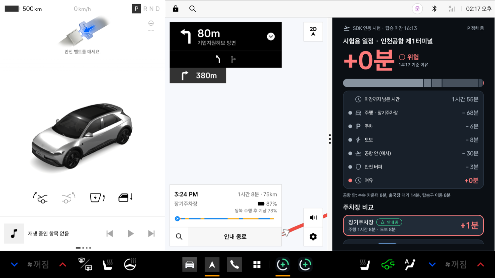

# 온타임 (OnTime)

내비는 언제 도착하는지 알려 줍니다. 온타임은 **도착했을 때 그곳이 어떨지** 알려 주는 Pleos Connect 차량용 앱입니다. 내비의 도착 예정 시각에 공공데이터 예보를 겹쳐, 도착할 때 붐빌 것 같으면 더 한적한 곳을, 마감에 늦을 것 같으면 더 가까운 주차장을 말로 제안합니다. 운전자가 "그렇게 해 줘"라고 답하면 내비 경로를 바꿉니다.

현대자동차그룹 차량용 앱 개발 공모전(Code your App into Pleos App Market) 출품작입니다.

[](brag-output/brag.mp4)

24초 소개 영상입니다. 이미지를 누르면 소리가 있는 MP4가 열립니다. 앞부분은 앱을 녹화한 화면이고 예시 데이터로 재생한 것입니다. 뒷부분은 Pleos Connect 에뮬레이터에서 실제 내비와 나란히 띄워 찍은 화면입니다.

## 두 가지 일정

같은 원리를 두 종류의 일정에 씁니다. 지금이 아니라 도착할 시각을 기준으로 판단하고, 그 시각은 차의 내비가 알려 줍니다.

| | 주말 나들이 | 공항 |
|---|---|---|
| 온타임이 보는 것 | 도착할 시간대의 혼잡 예보 | 탑승 마감까지 남는 여유 |
| 제안 | 덜 붐비는 곳 | 더 가까운 주차장 |
| 겹치는 데이터 | 관광지 집중률, 서울 실시간 도시데이터 (연동 예정) | 운항 현황, 승객예고, 주차면 현황 (연동 예정) |



### 주말 나들이: 도착할 때 붐빌까

출발할 때는 13:45 도착 예정이라 그 시간대 예보가 "보통"입니다. 정체로 도착이 14:04로 밀리면 14시대 예보인 "붐빔"으로 바뀌고, 온타임이 더 한적한 곳을 제안합니다.

| 정체로 도착이 붐비는 시간대로 밀림 | 수락 후 목적지 변경 |
|---|---|
|  |  |

정차 중에는 갈 만한 곳마다 도착 시각이 다르다는 점을 반영해, 각자의 도착 시각에 맞는 예보를 비교합니다.



### 공항: 탑승 마감까지의 여유

| 정체로 여유가 줄어 주차장 변경을 제안 | 정차 중 계산 내역과 주차장 비교 |
|---|---|
|  |  |

### 실제 내비와 나란히

운전 중에는 내비와 나란히 띄워 씁니다. 아래는 Pleos Connect 에뮬레이터에서 `pleos` 빌드를 내비 옆에 띄운 화면입니다. 왼쪽 내비가 안내하는 경로의 남은 시간(1시간 8분)을 온타임이 받아 여유를 계산하고, 다른 주차장까지의 소요 시간도 내비에 물어 비교합니다.



## 현재 상태 (1차 제출본)

실제로 동작하는 부분:

- 도착 예정 시각 기준의 혼잡 예보 판단, 덜 붐비는 곳 선택, 여유 시간 계산, 상태 판정, 대안 주차장 선택 (단위 테스트 46개)
- 주행 중에는 상태 하나만 크게 보여 주고, 정차 중에는 근거와 비교를 보여 주는 화면 전환
- 제안하고, 수락하면 목적지를 바꾸고, 바뀐 도착 시각으로 다시 판단하는 흐름
- `pleos` 빌드의 Pleos Connect SDK 호출: 경로 요청, 남은 주행 시간 수신, 다른 목적지까지의 소요 시간 조회, 기어 조회. 에뮬레이터에서 확인했습니다

예시 데이터이거나 아직 연결하지 않은 부분:

- **혼잡 예보는 예시 값입니다.** 장소와 시간대별로 적어 둔 표를 읽습니다. 직접 운영 중인 한적 서비스의 관광지 집중률과 서울 실시간 도시데이터로 바꿀 예정입니다.
- **공항 안 소요 시간(수속, 출국장 대기, 탑승구 이동)도 예시 값입니다.** 인천공항 승객예고와 출국장 혼잡도, 운항 현황으로 바꿀 예정입니다.
- 제출 APK(`fake` 빌드)의 현재 시각, 남은 주행 시간, 주행 여부는 시나리오를 20배속으로 재생한 값입니다. 화면에 "예시 데이터 재생"으로 표시합니다.
- 음성은 아직 연결하지 않았습니다. "그렇게 해 줘"라는 답은 4초 뒤 수락한 것으로 처리합니다. 에뮬레이터의 기기 내 음성 엔진이 오류를 내, 서버 모드 연결이 남아 있습니다.
- 나들이 일정은 아직 `fake` 빌드에만 있습니다. `pleos` 빌드는 공항 일정으로 SDK 연동을 확인합니다.
- 주차와 도보 시간, 버퍼 3분, 장소의 좌표는 설명용 가정입니다.

## 저장소 구성

| 경로 | 내용 |
|---|---|
| `vehicle-app/` | 차량 앱 (Kotlin, Jetpack Compose). `core-slack` 계산, `core-voice` 음성 답 해석, `core-session` 흐름(나들이는 `outing`, 공항은 `session`), `platform-api` 차량 입력 인터페이스, `platform-fake` 시나리오 재생, `platform-pleos` Pleos SDK 구현, `design-system` 디자인 시스템, `app` 화면 |
| `server/` | 운항 정보와 주차장 현황을 모아 차량 앱에 전달하는 서버 (예정) |
| `mobile-web/` | 하차 후 스마트폰에서 이어 보는 화면 (예정) |
| `apk/` | 제출용 release APK |
| `docs/` | 설계 문서, SDK 확인 기록, 공모전 규정 요약 |

## 실행 방법

APK를 바로 설치하려면 에뮬레이터를 띄운 뒤 아래 명령을 실행합니다.

```bash
adb install -r apk/장현호_온타임_release.apk
adb shell am start -n io.github.hyunolike.ontime/io.github.hyunolike.ontime.app.MainActivity
```

앱이 열리면 일정 목록에서 하나를 고르고 정차 화면의 "시연 시작"을 누릅니다. 뒤로 가기를 누르면 일정 목록으로 돌아옵니다.

- **주말 나들이**: 약 6초 뒤 정체로 도착이 13:45에서 14:04로 밀려 예보가 "보통"에서 "붐빔"으로 바뀌고, 물향기수목원을 제안받아 "여유"가 됩니다.
- **공항**: 약 6초 뒤 사고 정체로 여유가 +28분에서 +9분으로 줄고, 주차장을 바꿔 +21분이 됩니다.

### 내비와 나란히 띄우기 (Pleos Connect 에뮬레이터)

1. 에뮬레이터를 한국 시간대로 띄웁니다. 기본값이 미국 서부 시간이라 그대로 두면 내비의 도착 예정 시각과 온타임의 시각이 어긋납니다.

   ```bash
   ~/Library/Android/sdk/emulator/emulator -avd <Pleos 기기 이름> -no-snapshot \
     -dns-server 8.8.8.8,1.1.1.1 -timezone Asia/Seoul
   ```

2. 온타임을 연 상태에서 앱 영역 오른쪽 끝의 "⋮" 손잡이를 왼쪽으로 끌면 화면이 1:1로 나뉩니다. 빈 쪽에서 하단 바의 내비 아이콘을 누르면 내비가 들어옵니다.
3. 예시 데이터 빌드는 "시연 시작"을 누른 직후에 나누면 됩니다. 앱을 다시 실행하면 한 화면으로 돌아갑니다.

소스에서 빌드하려면 JDK 17과 Android SDK(플랫폼 34)가 필요합니다.

```bash
cd vehicle-app
./gradlew test                    # 단위 테스트
./gradlew :app:assembleFakeDebug   # 시나리오 재생 빌드
./gradlew :app:assemblePleosDebug  # Pleos SDK 연동 빌드 (Pleos Connect 에뮬레이터 필요)
```

release 빌드는 `vehicle-app/keystore.properties`가 있을 때만 서명됩니다. 키스토어는 저장소에 넣지 않았습니다.

## 테스트 환경 및 필요한 설정

- 실행 확인: Android 14 (API 34) arm64 에뮬레이터, 2560x1600 px, 320 dpi 가로 화면
- minSdk 28, targetSdk 34
- 별도 설정이나 API 키, 네트워크 연결이 필요 없습니다.
- 서버와 모바일 웹은 아직 없습니다. 추가되면 공공데이터포털 서비스 키가 필요하고, 키 없이도 저장된 응답으로 실행할 수 있게 만듭니다.

## Pleos Connect 에뮬레이터 버전과 화면 규격

- Pleos Connect Emulator v2.1.0 (Android API 34), 기기 프로필 `Pleos_Connect_v2_0`
- 화면 2560x1440 px, 160 dpi. 앱은 화면 오른쪽 영역에 표시됩니다.
- `pleos` 빌드를 이 에뮬레이터에서 실행해 NaviHelper 경로 요청과 남은 주행 시간 수신, 기어 상태 조회를 확인했습니다. 자세한 결과는 [Pleos SDK 확인 기록](docs/pleos-sdk-notes.md)에 있습니다.
- 제출 APK(`fake` 빌드)는 일반 Android 14 에뮬레이터(2560x1600 px, 320 dpi)에서 확인했습니다.

## APK 위치

[`apk/장현호_온타임_release.apk`](apk/장현호_온타임_release.apk)

## 사용하는 Pleos Connect SDK

`pleos` 빌드에서 NaviHelper, Vehicle, SpeechToText, TextToSpeech를 호출합니다. FusedLocation은 아직 연결하지 않았습니다.

| SDK | 버전 | 용도 |
|---|---|---|
| NaviHelper | 3.0.5 | 목적지 재설정, 경유지 추가, 경로 이벤트 수신 |
| Vehicle | 2.3.2 | 주행가능거리, 도어와 주행 상태 |
| SpeechToText | 3.3.1 | 일정 등록과 대안 수락 |
| TextToSpeech | 3.3.1 | 상태가 바뀔 때 음성 안내 |
| FusedLocation | 1.1.3 | 현재 위치 |

## 문서

- [0단계 구현 계획](docs/superpowers/plans/2026-11-13-stage0-minimal-build.md)
- [디자인 시스템](docs/design-system.md)
- [설계 문서](docs/superpowers/specs/2026-11-13-ontime-design.md)
- [Pleos SDK 확인 기록](docs/pleos-sdk-notes.md)
- [공모전 규정 요약](docs/contest-rules.md)
