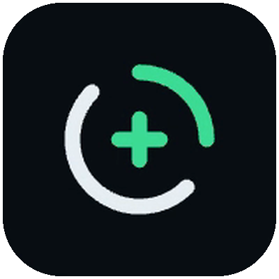
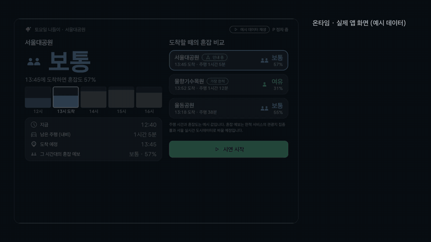
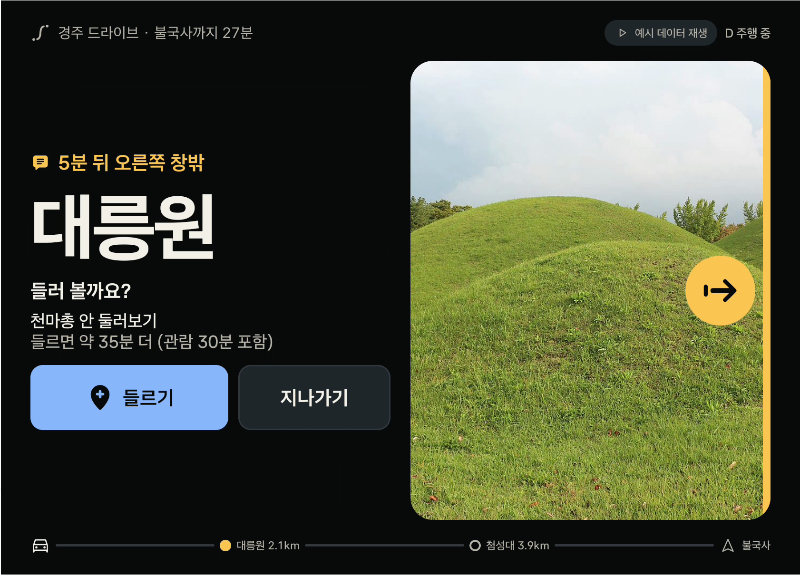
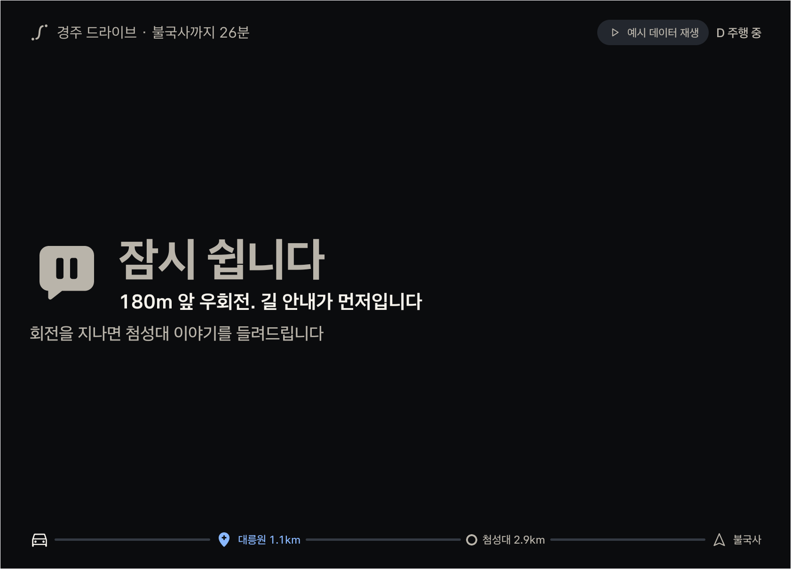
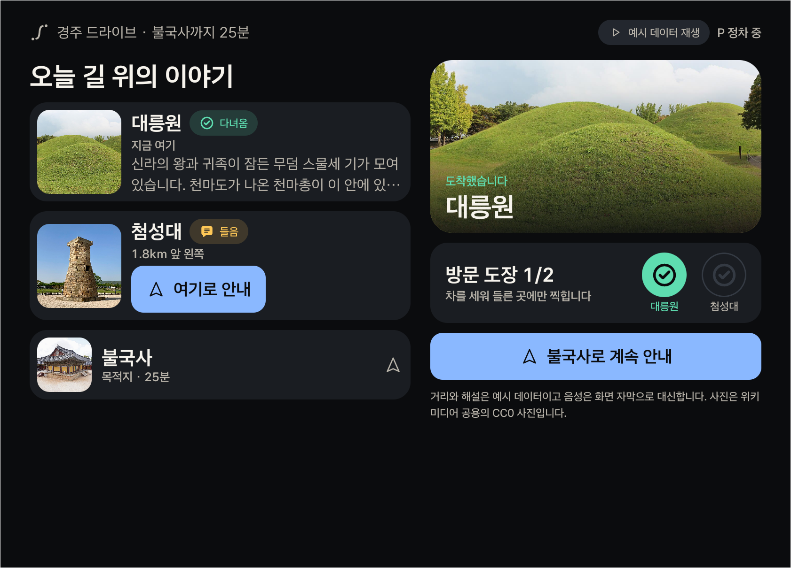
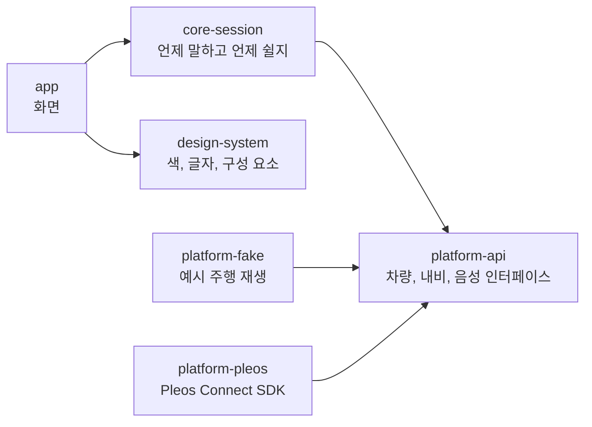

<div align="center">



# 길벗

곧 지나갈 곳의 이야기를 몇 분 뒤 어느 쪽 창밖인지와 함께 미리 들려주는 차량용 드라이브 도슨트

<br>

[](brag-output/brag.mp4)

이미지를 누르면 소리가 있는 26초 소개 영상이 열립니다.

</div>

<br>

## 소개

패키지 버스에는 이동 시간을 채워 주는 가이드가 있지만, 자차와 렌터카로 다니는 여행에는 없습니다. 길벗은 그 빈자리를 차가 채우게 하는 Pleos Connect 앱입니다.

내비가 아는 앞길을 보고 5분 뒤에 나올 곳을 미리 이야기하고, 그곳의 사진은 실제로 보일 쪽 창에 맞춰 띄웁니다. 회전이 가까우면 새 이야기를 꺼내지 않습니다. 들러 보고 싶어지면 가서 무엇을 볼 수 있는지, 도착이 얼마나 늦어지는지 확인한 뒤 버튼 한 번으로 경유지에 넣습니다. 그곳에 차를 세우면 방문 도장이 찍힙니다.

현대자동차그룹 차량용 앱 개발 공모전(Code your App into Pleos App Market) 출품작입니다.

<br>

## 화면

화면의 왼쪽과 오른쪽은 창밖의 왼쪽과 오른쪽과 같습니다.

| 곧 지나갈 곳을 미리 | 들를지 정할 때 필요한 것만 |
| :---: | :---: |
|  |  |
| 오른쪽 창밖에 나올 곳은 사진도 오른쪽에 | 볼거리와 늦어지는 시간을 보고 고릅니다 |

| 회전 앞에서는 쉬기 | 회전을 지나면 이어서 |
| :---: | :---: |
|  |  |
| 사진을 내리고 묻던 질문도 닫습니다 | 이번에는 왼쪽 창밖입니다 |

| 출발 전 | 들른 뒤 |
| :---: | :---: |
|  |  |
| 오늘 길에 나올 곳과 들르는 데 드는 시간 | 차를 세운 곳에만 도장이 찍힙니다 |

| 다음 곳으로 바로 안내 | 내비와 나란히 띄웠을 때 |
| :---: | :---: |
|  |  |
| 도착한 곳에서 다음 장소를 고르면 다시 출발합니다 | 폭이 좁으면 사진을 위로 올립니다 |

주행 중에 누를 수 있는 것은 들를지 묻는 순간의 버튼 두 개뿐입니다. 답하지 않으면 그대로 지나갑니다.

<br>

## 차가 알고 있는 것

| 차가 아는 것 | 길벗에서 쓰는 곳 | 쓸 SDK |
| --- | --- | --- |
| 앞으로 갈 길 | 몇 분 뒤에 나올 곳을 미리 이야기 | NaviHelper |
| 다음 회전까지의 거리 | 회전 400m 앞에서는 새 이야기를 시작하지 않고 질문을 닫음 | NaviHelper |
| 진행 방향 | 사진을 보일 쪽에 띄움 | FusedLocation |
| 기어 | P로 바뀐 곳에만 방문 도장 | Vehicle |
| 소리 | 해설을 읽어 주고 말로 답을 받음 | TextToSpeech, SpeechToText |

<br>

## 지금 되는 것과 남은 것

제출한 APK는 경주 시내를 지나 불국사로 가는 길을 10배속으로 재생합니다. 거리와 방향, 회전 위치, 들르는 데 드는 시간은 예시 값이고, 화면 위쪽에 예시 데이터 재생이라고 표시해 두었습니다.

지금 되는 것

- 이야기를 꺼낼 때와 쉴 때를 고르는 판단, 버튼으로 답해 경유지 넣기, 정차 화면에서 고른 곳으로 바로 안내, 방문 도장. 단위 테스트 50개로 확인합니다.
- 주행 화면과 정차 화면의 전환, 화면을 반으로 나눴을 때의 배치
- Pleos Connect SDK 호출. 별도의 `pleos` 빌드로 에뮬레이터에서 남은 시간과 거리, 소요 시간 조회, 경유지 추가, 회전 목록 조회, 기어 조회가 응답하는 것을 확인했습니다. 기록은 [SDK 확인 기록](docs/pleos-sdk-notes.md)에 있습니다.

남은 것

- 도슨트 화면을 위의 SDK 값에 연결하는 일. 지금 버튼은 예시 경로의 경유지를 바꿉니다.
- 음성. 에뮬레이터의 기기 내 음성 엔진이 오류를 내서 서버 모드로 연결해야 합니다. 그때까지 해설은 화면 자막으로 보여 줍니다.
- 위치 갱신. FusedLocation은 서비스 연결까지 확인했고, 차가 서 있는 에뮬레이터에서는 위치가 갱신되지 않아 확인하지 못했습니다.
- 해설과 사진. 해설은 널리 알려진 사실을 짧게 줄여 직접 쓴 예시 문장이고, 사진은 위키미디어 공용의 CC0 사진 3장입니다. 한국관광공사 관광 데이터로 바꿀 예정입니다.

`pleos` 빌드는 SDK를 확인하던 초기 프로토타입 화면으로 열립니다. 아래 화면의 공항 일정과 숫자는 시험용 값입니다.


<br>

## 실행 방법

에뮬레이터를 띄운 뒤 APK를 설치하고 실행합니다.

```bash
adb install -r apk/장현호_길벗_release.apk
adb shell am start -n io.github.hyunolike.ontime/io.github.hyunolike.ontime.app.MainActivity
```

앱이 열리면 경주 코스 시연 시작을 누릅니다.

1. 5초쯤 오른쪽 창밖에 나올 대릉원 이야기가 사진과 함께 나옵니다.
2. 9초쯤 들러 볼지 묻습니다. 여기서 들르기를 눌러 주세요. 10초쯤 기다립니다.
3. 19초쯤 우회전 앞에서 잠시 쉽니다. 그때까지 누르지 않았다면 질문이 닫히고 대릉원은 지나갑니다.
4. 23초쯤 회전을 지나 왼쪽 창밖의 첨성대 이야기가 이어집니다.
5. 30초쯤 대릉원에 도착해 방문 도장이 찍힙니다.

도착 화면에서 첨성대의 여기로 안내를 누르면 첨성대로, 불국사로 계속 안내를 누르면 목적지로 다시 출발합니다. 아무것도 누르지 않으면 두 곳을 지나 불국사까지 3분쯤 재생됩니다.

패키지 이름과 저장소 이름에 남은 `ontime`은 초기 프로토타입의 이름입니다.

### 소스에서 빌드

JDK 17과 Android SDK 플랫폼 34가 필요합니다.

```bash
cd vehicle-app
./gradlew test                     # 단위 테스트
./gradlew :app:assembleFakeDebug   # 예시 데이터 재생 빌드
./gradlew :app:assemblePleosDebug  # SDK 확인 빌드, Pleos Connect 에뮬레이터에서만 동작
```

release 빌드는 `vehicle-app/keystore.properties`가 있을 때만 서명됩니다. 키스토어는 저장소에 넣지 않았습니다.

### Pleos Connect 에뮬레이터를 띄울 때

명령줄로 띄우면 DNS를 잡지 못해 내비가 응답하지 않을 때가 있고, 기본 시간대가 미국 서부입니다.

```bash
~/Library/Android/sdk/emulator/emulator -avd <Pleos 기기 이름> -no-snapshot \
  -dns-server 8.8.8.8,1.1.1.1 -timezone Asia/Seoul
```

앱 영역 오른쪽 끝의 손잡이를 왼쪽으로 끌면 화면이 반으로 나뉘어 내비와 나란히 볼 수 있습니다.

<br>

## 테스트 환경 및 필요한 설정

- minSdk 28, targetSdk 34
- 제출 APK는 따로 설정할 것이 없고 API 키나 네트워크 연결도 필요하지 않습니다.

## 에뮬레이터 버전과 화면 규격

- Pleos Connect Emulator v2.1.0 (Android API 34), 기기 프로필 `Pleos_Connect_v2_0`
- 화면은 2560x1440 px, 160 dpi입니다. 앱 영역은 1682x1210 px이고, 내비와 나란히 띄우면 841x1210 px입니다.
- 제출 APK를 이 에뮬레이터에 설치해 위 순서가 끝까지 도는 것을 확인했습니다.

## APK 위치

[apk/장현호_길벗_release.apk](apk/장현호_길벗_release.apk)

<br>

## 기술 스택

| 구분 | 사용 기술 |
| --- | --- |
| 언어와 화면 | Kotlin 2.0.21, Jetpack Compose (BOM 2024.09.03) |
| 비동기 | Kotlin Coroutines 1.9.0 |
| 빌드 | Gradle 8.14.3, Android Gradle Plugin 8.13.2, JDK 17 |
| 테스트 | kotlin.test, kotlinx-coroutines-test |
| 차량 | Pleos Connect SDK |

| Pleos Connect SDK | 버전 | 쓰는 곳 | 확인한 범위 |
| --- | --- | --- | --- |
| NaviHelper | 3.0.5 | 남은 거리와 시간, 경유지 추가, 회전 안내 | 호출과 응답 확인, 도슨트 화면 연결 전 |
| Vehicle | 2.3.2 | 기어 P로 방문 확인, 주행 중 화면 제한 | 기어 조회 확인 |
| TextToSpeech | 3.3.1 | 해설 읽기 | 기기 내 엔진 오류, 서버 모드 연결 필요 |
| SpeechToText | 3.3.1 | 들를지 묻는 말에 대한 답 듣기 | 아직 확인하지 않음 |
| FusedLocation | 1.1.3 | 진행 방향으로 좌우 판단 | 서비스 연결 확인, 위치 갱신은 아직 |

<br>

## 구조

화면과 판단 로직은 차량 입력을 인터페이스로만 받습니다. 그래서 같은 화면을 예시 주행으로도, 실제 SDK로도 돌릴 수 있습니다.



| 경로 | 내용 |
| --- | --- |
| `vehicle-app/` | 차량 앱 |
| `apk/` | 제출용 release APK |
| `brag-output/` | 소개 영상과 썸네일, 효과음 출처 |
| `docs/` | SDK 확인 기록, 디자인 시스템, 공모전 규정 요약 |

`core-slack` 모듈과 `core-session`의 `session` 패키지는 초기 프로토타입의 코드이고, `pleos` 빌드의 SDK 확인 화면이 씁니다.

<br>

## 문서

- [SDK 확인 기록](docs/pleos-sdk-notes.md)
- [디자인 시스템](docs/design-system.md)
- [공모전 규정 요약](docs/contest-rules.md)

<br>

## 만든 사람

|  |
| :---: |
| [장현호](https://github.com/hyunolike) |
