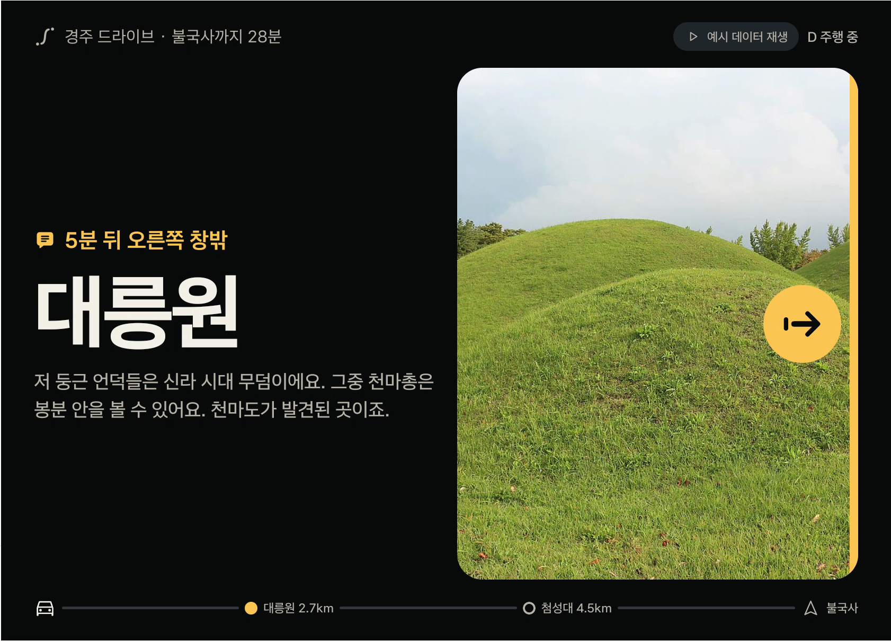
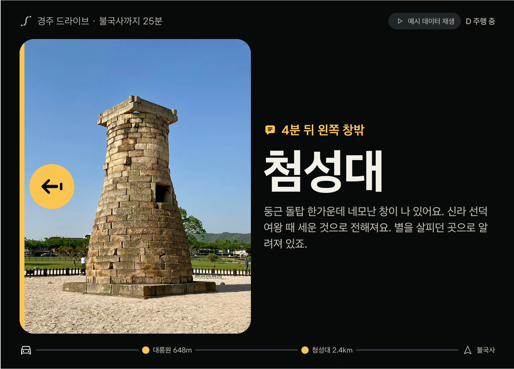
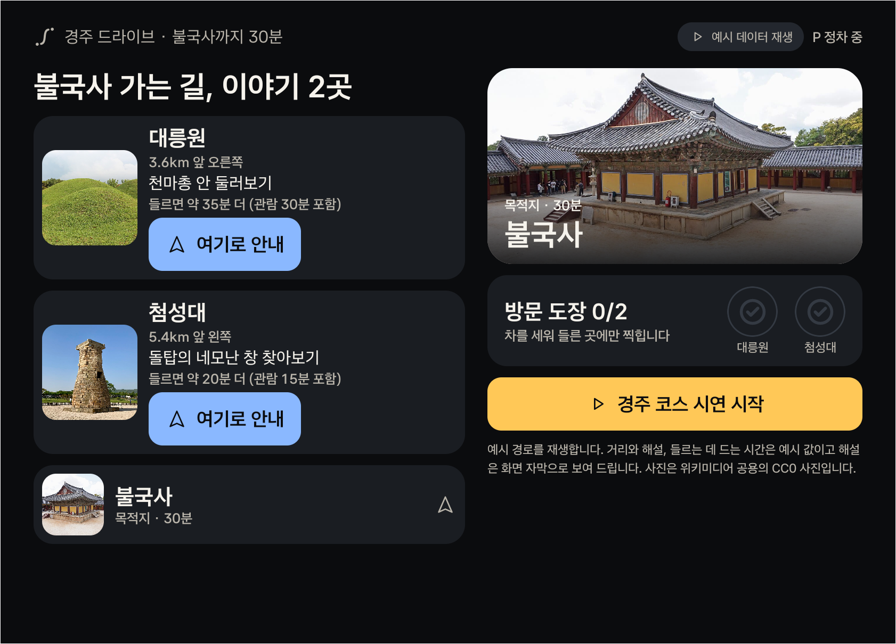
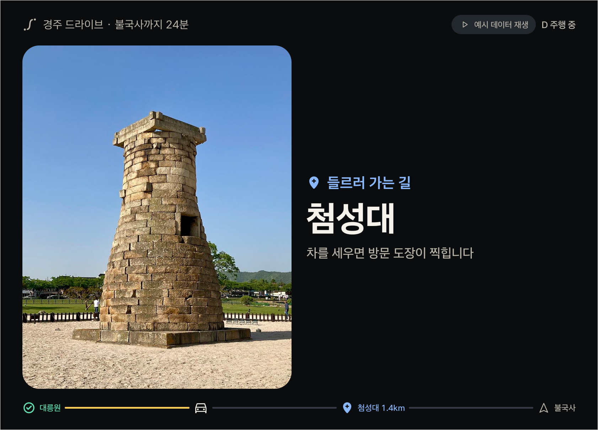
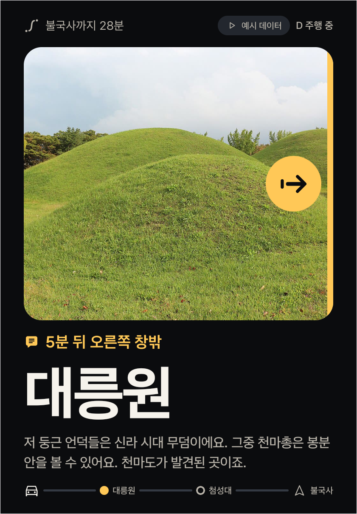

# 길벗: 드라이브 도슨트

차가 여행 가이드가 됩니다. 길벗은 곧 지나갈 곳의 이야기를 **몇 분 뒤 어느 쪽 창밖인지**와 함께 미리 들려주고, 회전이 가까우면 말을 멈추는 Pleos Connect 차량용 앱입니다. 그곳의 사진을 보일 쪽에 띄우고, 들르면 무엇을 보고 얼마나 늦어지는지 알려 준 뒤 "들르기"를 누르면 그곳을 경유지로 넣습니다. 차를 세워 들르면 방문 도장을 찍습니다.

**제출 APK는 경주 예시 주행을 재생합니다.** 해설은 음성 대신 화면 자막으로 나오고, 버튼은 재생 중인 예시 경로의 경유지를 바꿉니다. 실제 내비와 음성 연결은 [현재 상태](#현재-상태-1차-제출본)에 적은 만큼만 되어 있습니다.

현대자동차그룹 차량용 앱 개발 공모전(Code your App into Pleos App Market) 출품작입니다.

[](brag-output/brag.mp4)

26초 소개 영상입니다. 이미지를 누르면 소리가 있는 MP4가 열립니다. 앱을 Pleos Connect 에뮬레이터에서 녹화한 화면이고, 거리와 해설은 예시 데이터입니다. 영상 속 "들르기"는 손으로 누른 것이고, 누른 자리에 원을 덧그렸습니다.

## 왜 차에서 하는가

패키지 버스에는 이동 시간을 채워 주는 가이드가 있지만 자차와 렌터카 여행에는 없습니다. 길벗은 내비가 아는 앞길과 다음 회전, 차가 아는 정차 여부를 써서 언제 말하고 언제 물을지를 정합니다.

| 차가 아는 것 | 쓰임 | SDK |
|---|---|---|
| 앞으로 갈 길 | "5분 뒤"에 나올 곳을 미리 예고 | NaviHelper |
| 어느 쪽 창밖인지 | "오른쪽에 보이는" | FusedLocation |
| 지금 말해도 되는지 | 회전 앞에서는 말을 멈춤 | NaviHelper 회전 안내 |
| 정말 들렀는지 | 차를 세운 곳에만 방문 도장 | Vehicle 기어 |
| 말로 주고받기 | 해설을 들려주고 "들를래"를 알아들음 | TextToSpeech, SpeechToText |

## 화면

화면의 좌우는 창밖의 좌우와 같습니다. 오른쪽에 보일 곳은 사진이 오른쪽에, 왼쪽에 보일 곳은 왼쪽에 옵니다.

| 곧 지나갈 곳을 사진과 함께 미리 | 무엇을 보고 얼마나 늦어지는지 알려 주고 묻기 |
|---|---|
|  |  |

| 회전 앞에서는 사진도 내리고 쉼 | 지나면 다시 이어서 |
|---|---|
|  |  |

주행 중에 누를 수 있는 것은 "들러 볼까요?"에 답하는 큰 버튼 두 개뿐입니다. 답하지 않으면 그대로 지나갑니다. 묻는 중에 회전이 가까워지면 질문을 닫고 화면을 비웁니다.

정차 중에는 오늘 길 위의 장소를 사진과 함께 보여 줍니다. 아직 앞에 있는 곳은 "여기로 안내"를 누르면 경유지로 들어갑니다.

| 출발 전 | 들른 뒤 |
|---|---|
|  |  |

| 도착한 곳에서 다음 곳으로 바로 안내 | 내비와 화면을 반씩 나눴을 때 |
|---|---|
|  |  |

색과 글자, 구성 요소의 규칙은 [디자인 시스템 문서](docs/design-system.md)에 있습니다.

## 현재 상태 (1차 제출본)

실제로 동작하는 부분:

- 이야기를 시작할 시점 판단(3km 앞에서 미리, 500m 안이면 건너뜀), 회전 400m 앞에서의 침묵, 버튼으로 답해 경유지 추가, 답이 없거나 회전이 가까우면 질문 닫기, 정차 화면에서 고른 곳으로 바로 안내, 방문 도장 (단위 테스트 50개)
- 주행 중에는 사진 한 장과 이름 하나만 크게, 정차 중에는 장소 목록과 도장을 보여 주는 화면 전환. 화면을 반으로 나눠도 배치가 맞춰집니다
- 도슨트에 쓰는 Pleos Connect SDK 호출을 별도의 `pleos` 빌드로 에뮬레이터에서 확인했습니다: 남은 시간과 거리 수신, **경유지 추가, 회전 목록 조회**, 소요 시간 조회, 기어 조회. 현재 위치와 진행 방향은 차가 서 있는 상태의 응답까지 확인했습니다 ([확인 기록](docs/pleos-sdk-notes.md))

예시 데이터이거나 아직 연결하지 않은 부분:

- **제출 APK(`fake` 빌드)는 경주 드라이브를 10배속으로 재생합니다.** 거리, 방향, 회전 위치, 들르는 데 드는 시간은 예시 값이고 화면에 "예시 데이터 재생"으로 표시합니다.
- **해설은 예시 문장입니다.** 널리 알려진 사실을 짧게 줄여 직접 썼습니다. 한국관광공사 관광 데이터로 바꿀 예정입니다.
- **사진은 앱에 넣어 둔 3장입니다.** 위키미디어 공용의 CC0 사진이고 출처는 [디자인 시스템 문서](docs/design-system.md)에 적었습니다. 관광 데이터의 대표 사진을 받아 오는 부분은 아직 없습니다.
- **길 안내는 예시 드라이브 안에서만 바뀝니다.** "들르기"와 "여기로 안내"는 제출 APK에서 재생 중인 예시 경로의 경유지를 바꿉니다. 실제 내비의 경유지 추가 호출은 따로 확인했고, 이 버튼에 연결하는 일이 남았습니다.
- **음성은 아직 연결하지 않았습니다.** 해설은 화면 자막으로 대신하고, "들러 볼까요?"에는 버튼으로만 답합니다. 음성이 연결되면 "들를래"라고 말해도 되게 할 계획이지만 지금 화면에는 그 안내를 내지 않습니다. 에뮬레이터의 기기 내 음성 엔진이 오류를 내서 서버 모드 연결이 남아 있습니다.
- **도슨트 화면은 아직 실제 SDK 값에 연결하지 않았습니다.** 필요한 호출은 하나씩 확인했지만, 도슨트 화면은 예시 데이터로만 돕니다. FusedLocation은 지원 여부와 서비스 연결까지 확인했고, 차가 서 있어 위치 갱신은 받지 못했습니다.
- `pleos` 빌드는 SDK 연동을 확인하던 초기 프로토타입 화면(공항 가는 길의 여유 시간 계산)으로 열립니다. 위 확인 기록은 이 빌드로 얻었습니다.


## 저장소 구성

| 경로 | 내용 |
|---|---|
| `vehicle-app/` | 차량 앱 (Kotlin, Jetpack Compose) |
| `vehicle-app/core-session/.../docent` | 도슨트 흐름: 언제 말하고 언제 멈출지 |
| `vehicle-app/platform-api` | 차량, 내비, 음성, 길 상황, 이야기 인터페이스 |
| `vehicle-app/platform-fake` | 예시 드라이브 재생 |
| `vehicle-app/platform-pleos` | Pleos Connect SDK 구현 |
| `vehicle-app/design-system` | 색, 글자, 간격 토큰과 구성 요소 |
| `vehicle-app/core-slack`, `core-session/.../session` | 초기 프로토타입(여유 시간 계산). `pleos` 빌드의 SDK 확인 화면이 씁니다 |
| `apk/` | 제출용 release APK |
| `docs/` | SDK 확인 기록, 디자인 시스템, 공모전 규정 요약 |

## 실행 방법

APK를 바로 설치하려면 에뮬레이터를 띄운 뒤 아래 명령을 실행합니다.

```bash
adb install -r apk/장현호_길벗_release.apk
adb shell am start -n io.github.hyunolike.ontime/io.github.hyunolike.ontime.app.MainActivity
```

앱이 열리면 "경주 코스 시연 시작"을 누릅니다. 다음 순서로 진행됩니다.

1. 5초쯤: "5분 뒤 오른쪽 창밖, 대릉원" 이야기와 사진
2. 9초쯤: "들러 볼까요?"와 함께 볼거리, 늦어지는 시간이 뜹니다. **여기서 "들르기"를 눌러 주세요.** 10초쯤 열려 있습니다
3. 19초쯤: 우회전 앞에서 "잠시 쉽니다". 그때까지 누르지 않았다면 질문이 닫히고 대릉원은 지나갑니다
4. 23초쯤: 회전을 지나 "4분 뒤 왼쪽 창밖, 첨성대" 이야기
5. 30초쯤: "들르기"를 눌렀다면 대릉원에 도착, 방문 도장

도착한 화면에서 첨성대의 "여기로 안내"를 누르면 첨성대로, "불국사로 계속 안내"를 누르면 목적지로 다시 출발합니다. 출발 전에 "여기로 안내"를 먼저 눌러 들를 곳을 정해 둘 수도 있습니다. 아무것도 누르지 않으면 두 곳을 지나 불국사까지 3분쯤 재생됩니다.

패키지 이름과 저장소 이름에 남아 있는 `ontime`은 초기 프로토타입의 이름입니다.

소스에서 빌드하려면 JDK 17과 Android SDK(플랫폼 34)가 필요합니다.

```bash
cd vehicle-app
./gradlew test                     # 단위 테스트
./gradlew :app:assembleFakeDebug   # 예시 데이터 재생 빌드
./gradlew :app:assemblePleosDebug  # Pleos SDK 연동 확인 빌드 (Pleos Connect 에뮬레이터 필요)
```

release 빌드는 `vehicle-app/keystore.properties`가 있을 때만 서명됩니다. 키스토어는 저장소에 넣지 않았습니다.

### Pleos Connect 에뮬레이터를 띄울 때

기본 시간대가 미국 서부이고, 명령줄로 띄우면 DNS를 못 잡아 내비가 응답하지 않는 경우가 있습니다.

```bash
~/Library/Android/sdk/emulator/emulator -avd <Pleos 기기 이름> -no-snapshot \
  -dns-server 8.8.8.8,1.1.1.1 -timezone Asia/Seoul
```

앱 영역 오른쪽 끝의 "⋮" 손잡이를 왼쪽으로 끌면 화면이 1:1로 나뉘어 내비와 나란히 띄울 수 있습니다.

## 테스트 환경 및 필요한 설정

- minSdk 28, targetSdk 34
- 제출 APK는 별도 설정이나 API 키, 네트워크 연결이 필요 없습니다.

## Pleos Connect 에뮬레이터 버전과 화면 규격

- Pleos Connect Emulator v2.1.0 (Android API 34), 기기 프로필 `Pleos_Connect_v2_0`
- 화면 2560x1440 px, 160 dpi. 앱은 화면 오른쪽 영역(1682x1210 px)에 표시되고, 내비와 나란히 띄우면 841x1210 px입니다.
- 제출 APK를 이 에뮬레이터에 설치해 위 시연 순서가 끝까지 도는 것을 확인했습니다.

## APK 위치

[`apk/장현호_길벗_release.apk`](apk/장현호_길벗_release.apk)

## 사용하는 Pleos Connect SDK

| SDK | 버전 | 도슨트에서의 용도 | 상태 |
|---|---|---|---|
| NaviHelper | 3.0.5 | 남은 거리와 시간, 경유지 추가, 회전 안내 | `pleos` 빌드로 호출과 응답을 확인. 도슨트 화면에는 아직 연결하지 않음 |
| Vehicle | 2.3.2 | 기어 P로 방문 확인, 주행 중 화면 제한 | 기어 조회 확인 |
| TextToSpeech | 3.3.1 | 해설 읽기 | 에뮬레이터의 기기 내 엔진 오류. 서버 모드 연결 필요 |
| SpeechToText | 3.3.1 | "들를래" 같은 답 듣기 | 미확인 |
| FusedLocation | 1.1.3 | 진행 방향으로 좌우 판단, 근접 알림 | 지원과 서비스 연결 확인. 런타임 권한 필요. 위치 갱신은 미확인 |

## 문서

- [Pleos SDK 확인 기록](docs/pleos-sdk-notes.md)
- [디자인 시스템](docs/design-system.md)
- [공모전 규정 요약](docs/contest-rules.md)
- 초기 프로토타입(여유 시간 계산)의 [설계](docs/superpowers/specs/2026-11-13-ontime-design.md)와 [구현 계획](docs/superpowers/plans/2026-11-13-stage0-minimal-build.md)
