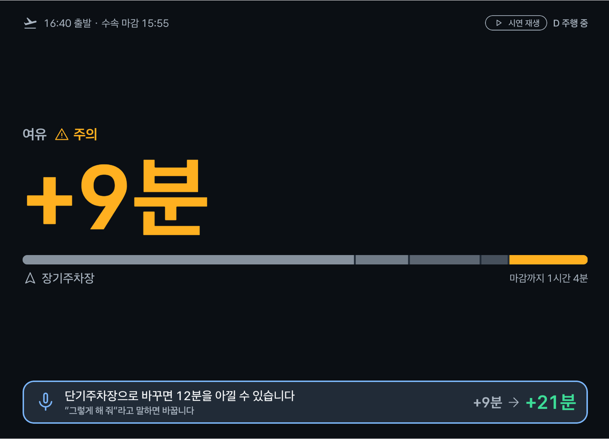
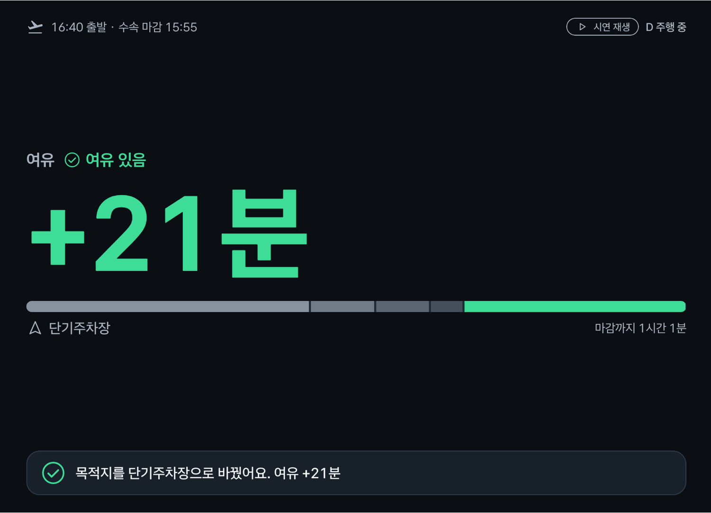
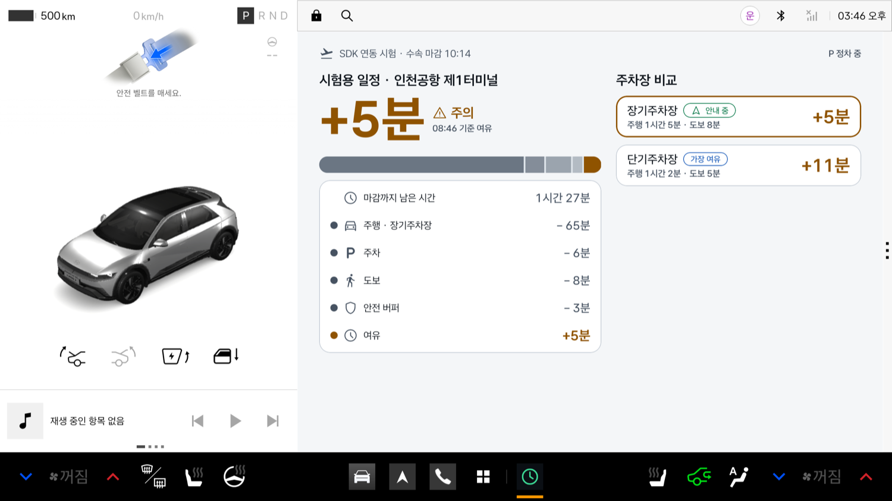

# 온타임 (OnTime)

늦으면 안 되는 시각에서 거꾸로 계산해, 주행 중에는 "여유 +9분"이라는 숫자 하나로 제시간 도착 여부를 알려 주는 차량용 정시 도착 도우미입니다. 늦어질 것 같으면 더 가까운 주차장이나 충전 경유지를 말로 제안하고, 운전자가 "그렇게 해 줘"라고 답하면 내비 경로를 바꿉니다.

현대자동차그룹 차량용 앱 개발 공모전(Code your App into Pleos App Market) 출품작입니다.

## 현재 상태 (0단계)

기획서 시나리오 A의 고속도로 장면을 **재생 데이터로** 보여 주는 최소 동작본입니다.

| 주행 중: 정체로 여유가 줄어 제안 | 수락 후 목적지 변경 |
|---|---|
|  |  |

정차 중에는 계산 내역과 주차장 비교를 보여 줍니다.


Pleos Connect 에뮬레이터에서 실제 내비 값으로 계산한 화면입니다(`pleos` 빌드).



실제로 동작하는 부분:

- 여유 시간 계산, 상태 판정(여유, 주의, 위험), 대안 주차장 선택 (단위 테스트 38개)
- 주행 중에는 숫자 하나만 보여 주고, 정차 중에는 계산 내역을 보여 주는 화면 전환
- 여유가 줄면 주차장 변경을 제안하고, 수락하면 목적지를 바꿔 여유를 다시 계산하는 흐름

아직 재생이거나 가정인 부분:

- 현재 시각, 남은 주행 시간, 주행 여부는 시나리오 파일을 20배속으로 재생한 값입니다. 화면에 "시연 재생"으로 표시합니다.
- 음성은 아직 연결하지 않았습니다. "그렇게 해 줘"라는 답은 4초 뒤 수락한 것으로 처리합니다.
- 주차 6분, 도보 8분과 5분, 버퍼 3분은 설명용 가정입니다.
- 제출 APK(`fake` 빌드)는 Pleos Connect SDK를 호출하지 않습니다. SDK 구현은 `platform-pleos` 모듈에 있습니다. `pleos` 빌드를 Pleos Connect 에뮬레이터에서 실행해 경로 요청, 남은 주행 시간 수신, 다른 주차장까지의 소요 시간 조회, 기어 조회를 확인했습니다. 음성은 에뮬레이터의 기기 내 엔진 오류로 아직 동작하지 않습니다.

## 저장소 구성

| 경로 | 내용 |
|---|---|
| `vehicle-app/` | 차량 앱 (Kotlin, Jetpack Compose). `core-slack` 계산, `core-voice` 음성 답 해석, `core-session` 흐름, `platform-api` 차량 입력 인터페이스, `platform-fake` 시나리오 재생, `platform-pleos` Pleos SDK 구현, `design-system` 디자인 시스템, `app` 화면 |
| `server/` | 운항 정보와 주차장 현황을 모아 차량 앱에 전달하는 서버 (예정) |
| `mobile-web/` | 하차 후 스마트폰에서 이어 보는 화면 (예정) |
| `apk/` | 제출용 release APK |
| `docs/` | 설계 문서, SDK 확인 기록, 공모전 규정 요약 |

## 실행 방법

APK를 바로 설치하려면 에뮬레이터를 띄운 뒤 아래 명령을 실행합니다.

```bash
adb install -r apk/장현호_온타임_release.apk
adb shell am start -n io.github.hyunolike.ontime/io.github.hyunolike.ontime.app.MainActivity
```

앱이 열리면 정차 화면의 "시연 시작"을 누릅니다. 약 10초 뒤 사고 정체로 여유가 +28분에서 +9분으로 줄고, 주차장을 바꿔 +21분이 된 뒤 약 1분 40초 지점에서 도착합니다.

소스에서 빌드하려면 JDK 17과 Android SDK(플랫폼 34)가 필요합니다.

```bash
cd vehicle-app
./gradlew test                    # 단위 테스트
./gradlew :app:assembleFakeDebug   # 시나리오 재생 빌드
./gradlew :app:assemblePleosDebug  # Pleos SDK 연동 빌드 (Pleos Connect 에뮬레이터 필요)
```

release 빌드는 `vehicle-app/keystore.properties`가 있을 때만 서명됩니다. 키스토어는 저장소에 넣지 않았습니다.

## 테스트 환경 및 필요한 설정

- 실행 확인: Android 14 (API 34) arm64 에뮬레이터, 2560x1600 px, 320 dpi 가로 화면
- minSdk 28, targetSdk 34
- 별도 설정이나 API 키, 네트워크 연결이 필요 없습니다.
- 서버와 모바일 웹은 아직 없습니다. 추가되면 공공데이터포털 서비스 키가 필요하고, 키 없이도 저장된 응답으로 실행할 수 있게 만듭니다.

## Pleos Connect 에뮬레이터 버전과 화면 규격

- Pleos Connect Emulator v2.1.0 (Android API 34), 기기 프로필 `Pleos_Connect_v2_0`
- 화면 2560x1440 px, 160 dpi. 앱은 화면 오른쪽 영역에 표시됩니다.
- `pleos` 빌드를 이 에뮬레이터에서 실행해 NaviHelper 경로 요청과 남은 주행 시간 수신, 기어 상태 조회를 확인했습니다. 자세한 결과는 [Pleos SDK 확인 기록](docs/pleos-sdk-notes.md)에 있습니다.
- 제출 APK(`fake` 빌드)는 일반 Android 14 에뮬레이터(2560x1600 px, 320 dpi)에서 확인했습니다.

## APK 위치

[`apk/장현호_온타임_release.apk`](apk/장현호_온타임_release.apk)

## 사용하는 Pleos Connect SDK

`pleos` 빌드에서 NaviHelper, Vehicle, SpeechToText, TextToSpeech를 호출합니다. FusedLocation은 아직 연결하지 않았습니다.

| SDK | 버전 | 용도 |
|---|---|---|
| NaviHelper | 3.0.5 | 목적지 재설정, 경유지 추가, 경로 이벤트 수신 |
| Vehicle | 2.3.2 | 주행가능거리, 도어와 주행 상태 |
| SpeechToText | 3.3.1 | 일정 등록과 대안 수락 |
| TextToSpeech | 3.3.1 | 상태가 바뀔 때 음성 안내 |
| FusedLocation | 1.1.3 | 현재 위치 |

## 문서

- [0단계 구현 계획](docs/superpowers/plans/2026-11-13-stage0-minimal-build.md)
- [디자인 시스템](docs/design-system.md)
- [설계 문서](docs/superpowers/specs/2026-11-13-ontime-design.md)
- [Pleos SDK 확인 기록](docs/pleos-sdk-notes.md)
- [공모전 규정 요약](docs/contest-rules.md)
