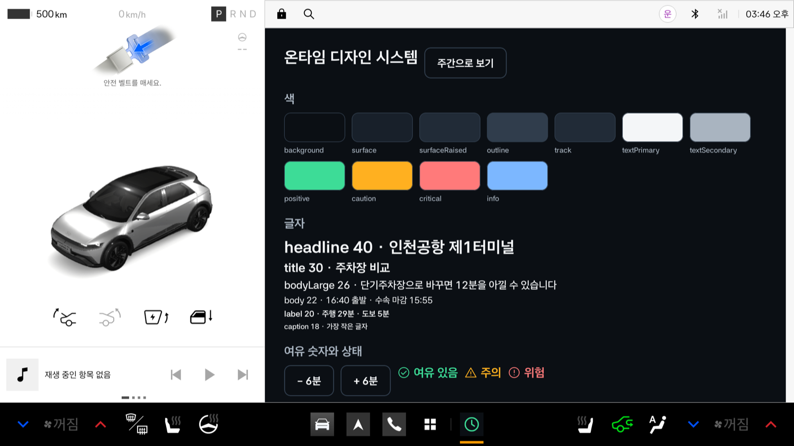

# 온타임 디자인 시스템

코드는 `vehicle-app/design-system` 모듈에 있습니다. 화면(`app`)은 색, 글자, 간격을 직접 쓰지 않고 이 모듈의 토큰과 구성 요소만 씁니다.



디버그 빌드에는 구성 요소를 한 화면에서 확인하는 갤러리가 들어 있습니다. 주간과 야간을 바꿔 볼 수 있습니다.

```bash
adb shell am start -n io.github.hyunolike.ontime/io.github.hyunolike.ontime.app.GalleryActivity
```

## 기준으로 삼은 것

[Pleos Connect UI Design Guide](https://document.pleos.ai/docs/connect/guide/docs-design/Introduction/intro)의 본문에서 확인한 규칙을 따랐습니다. 가이드의 색상값과 글자 크기, 버튼 치수는 그림과 Figma 파일 안에만 있어 그대로 옮기지 못했고, 그 부분은 아래 "가이드에 수치가 없어 직접 정한 것"에 따로 적었습니다.

| 가이드의 규칙 | 온타임에서의 적용 |
|---|---|
| 지정 서체는 Asta Sans | Asta Sans 가변 서체를 넣어 400~800 굵기로 씀 (SIL OFL 1.1) |
| 글자와 아이콘의 대비율 4.5:1 이상 | 주간과 야간의 모든 글자색, 상태색 조합을 단위 테스트로 검사 (`ContrastTest`) |
| 핵심 정보 글자 높이 5mm, 보조 글자 3mm 이상 | 14.6인치 화면 기준으로 가장 작은 글자가 3mm가 되게 크기 단계를 잡음 |
| 운전자는 1~2초 안에 정보를 파악 | 주행 화면에는 여유 숫자 하나와 상태만 크게 둠 |
| 주행 중 애니메이션 이미지와 자동 스크롤, 반복 움직임 금지 | 움직임은 값이나 상태가 바뀔 때 한 번뿐. 반복되는 움직임은 쓰지 않음 |
| 주행 중 문장은 세 줄 이하 | `Text`의 기본 최대 줄 수가 3 |
| 입력에 대한 응답은 0.25초 이내 | 버튼 눌림 반응 0.12초 |
| 아이콘은 48dp 격자, 글자 라벨과 함께 | Material Symbols Rounded 48dp. 상태는 아이콘, 글자, 색을 함께 씀 |
| 주간과 야간 모드 지원 | 두 색 구성을 모두 갖췄고, 앱은 지금 야간으로 고정. 시스템 설정을 따르게 하는 것은 한 줄 변경 |
| 가로와 세로 레이아웃 모두 대응, 앱 두 개가 나란히 뜸 | 앱 영역 크기에 비례해 전체를 키우거나 줄이고, 정차 화면은 가로에서 두 단, 세로에서 한 단 |

## 설계 원칙

1. **주행 중에는 조용하게, 정차 중에는 풍부하게.** 주행 화면은 누를 수 있는 요소가 없고 움직임이 거의 없습니다. 비교하고 고르는 일은 정차 화면에서만 합니다.
2. **숫자 하나가 중심입니다.** 여유 숫자는 한 화면에 하나만 두고 가장 크게 씁니다.
3. **쓰는 시간은 가라앉히고 남는 여유만 색을 씁니다.** 시간 예산 막대에서 주행, 주차, 도보, 버퍼는 회색의 농도로만 구분하고 여유 구간만 상태색으로 칠합니다.
4. **색만으로 알리지 않습니다.** 여유, 주의, 위험은 색과 함께 아이콘 모양과 글자가 달라집니다.
5. **재생한 값은 표시합니다.** 시연용 값이 섞이면 "시연 재생" 표식을 항상 같은 자리에 둡니다.

## 토큰

### 색 (`theme/ColorScheme.kt`)

원시값은 `tokens/Palette.kt`에 있고 화면에서는 의미 이름으로만 씁니다.

| 이름 | 쓰임 | 야간 | 주간 |
|---|---|---|---|
| `background` | 화면 바탕 | `#0B0F14` | `#F4F6F8` |
| `surface` | 카드 | `#18202A` | `#FFFFFF` |
| `surfaceRaised` | 선택된 카드 | `#212B37` | `#FFFFFF` |
| `outline` | 테두리 | `#303D4C` | `#C3CBD4` |
| `track` | 막대의 빈 자리 | `#212B37` | `#DCE2E8` |
| `textPrimary` | 본문 | `#F4F6F8` | `#10161D` |
| `textSecondary` | 보조 글자, 중립 구간 | `#A9B4C0` | `#465261` |
| `positive` | 여유 있음, 주 버튼 | `#3DDC97` | `#0B7A4B` |
| `caution` | 주의 | `#FFB020` | `#8F5300` |
| `critical` | 위험, 실패 | `#FF7A7A` | `#C62828` |
| `info` | 듣는 중, 안내 | `#7CB7FF` | `#1759B8` |

### 글자 (`theme/Typography.kt`)

기준 화면(가로 1280dp)에서의 크기입니다. 숫자는 값이 바뀌어도 자리가 흔들리지 않게 고정폭 숫자를 씁니다.

| 이름 | 크기 | 굵기 | 쓰임 |
|---|---|---|---|
| `display` | 190 | 800 | 주행 화면의 여유 숫자 |
| `displaySmall` | 112 | 800 | 정차 화면의 여유 숫자 |
| `headline` | 40 | 700 | 화면 제목, 비교 카드의 숫자 |
| `title` | 30 | 700 | 구역 제목, 상태 |
| `bodyLarge` | 26 | 500 | 제안 문장, 버튼 |
| `body` | 22 | 400 | 본문 |
| `label` | 20 | 600 | 보조 정보 |
| `caption` | 18 | 500 | 가장 작은 글자 |

### 간격과 모양 (`theme/Dimens.kt`)

- 간격: 4, 8, 12, 16, 24, 32, 48. 4의 배수만 씁니다.
- 모서리: 8, 16, 24, 알약 모양.
- 최소 터치 크기: 76dp.
- 움직임: 빠름 120ms, 보통 240ms, 강조 420ms.

## 구성 요소 (`component/`)

| 구성 요소 | 설명 |
|---|---|
| `SlackNumber` | 여유 숫자. 늘면 아래에서, 줄면 위에서 들어옵니다. 주행 중에는 짧게 겹쳐 바꿉니다 |
| `TimeBudgetBar` | 마감까지의 시간을 주행, 주차, 도보, 버퍼, 여유로 나눈 막대. 정차 중에는 구간을 눌러 고를 수 있습니다 |
| `StatusBadge` | 아이콘과 글자로 상태를 알립니다 |
| `Button` | 주 버튼과 보조 버튼. 눌림, 비활성, 로딩 상태 |
| `Card` | 내용을 묶는 면. 선택되면 테두리로 강조하고, 누를 수 있게 만들 수 있습니다 |
| `Chip` | "시연 재생", "안내 중" 같은 작은 표식 |
| `Icon`, `Text` | 토큰만 받도록 감싼 기본 요소 |

## 화면 패턴

- **주행 화면**: 일정 한 줄, 상태, 여유 숫자, 시간 예산 막대, 목적지. 제안이 있을 때만 아래에 한 줄이 나타났다가 결과를 8초 보여 주고 사라집니다.
- **정차 화면**: 왼쪽은 숫자가 어떻게 나왔는지의 내역이고 막대와 목록이 서로 연결됩니다. 오른쪽은 주차장 비교이고 누르면 그 주차장으로 목적지를 바꿉니다.
- **대기 화면**: 경로가 없을 때 안내를 시작하는 버튼 하나.

## 가이드에 수치가 없어 직접 정한 것

- 색상값 전부. 가이드의 토큰 이름 체계(Background, Surface, Text 등)에 맞춰 이름을 짓고 대비 기준만 지켰습니다. 상태색은 온타임이 정한 것입니다.
- 글자 크기 단계. 가이드의 계층 이름(Headline, Title, Body, Label)을 따르되 값은 최소 글자 높이 규칙에서 역산했습니다.
- 최소 터치 크기 76dp. Pleos 가이드에 수치가 없어 Android Automotive의 기준을 따랐습니다.
- 간격, 모서리, 움직임 시간.

가이드가 제공하는 Figma 파일 두 개(display guide, design assets)를 열어 실제 값과 맞춰 보는 일이 남아 있습니다.

## 외부 자산

| 자산 | 출처 | 라이선스 |
|---|---|---|
| Asta Sans | Google Fonts, 42dot | SIL Open Font License 1.1 (`vehicle-app/design-system/ASTA_SANS_OFL.txt`) |
| 아이콘 16종 | Google Material Symbols Rounded | Apache License 2.0 |
| 혼잡 단계 4종, 나들이, 도착 예보 아이콘 | Codex로 만든 벡터 | 자체 제작 |
| 앱 아이콘 | Codex로 만든 벡터 | 자체 제작 |
