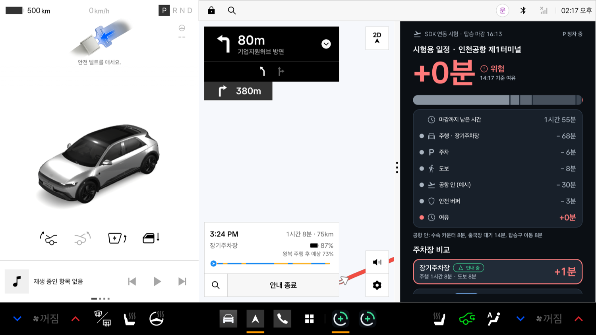

# Pleos SDK 확인 기록

공식 문서(https://document.pleos.ai)를 2026-11-13에 읽고 정리했습니다. 각 항목의 상태를 세 가지로 구분합니다.

- **문서 확인**: 문서에 적혀 있음. 에뮬레이터에서 직접 돌려 보지는 않음
- **미확인**: 문서에서 찾지 못함. PoC로 확인해야 함
- **SDK 확인**: 배포된 SDK 파일(AAR)의 클래스와 메서드를 직접 열어 확인함. 컴파일까지 됨. 값의 단위와 실제 응답은 모름
- **에뮬레이터 검증**: 직접 실행해 응답을 받음. 아래 "에뮬레이터에서 확인한 것" 참고

API Reference 페이지는 스크립트로 그려져 본문을 읽지 못했습니다. 대신 SDK 파일을 받아 직접 확인한 내용을 아래 "SDK 파일에서 확인한 것"에 정리했습니다.

## 에뮬레이터에서 확인한 것 (2026-11-13)

환경: Apple Silicon Mac, Pleos Connect Emulator v2.1.0 (`system-images;android-34;pleos_car_emulator;arm64-v8a`), 기기 프로필 `Pleos_Connect_v2_0`, 화면 2560x1440 px, 160 dpi. 앱은 화면 오른쪽 영역(약 1,700x1,200 px)에 뜬다.

| 항목 | 결과 |
|---|---|
| 에뮬레이터 부팅 | Apple Silicon에서 정상 부팅. 콜드 부팅, RAM 4GB, GPU host |
| `NaviHelper.initialize()` | 성공. 서비스 버전 3.0.4 |
| `requestRoute()` | 성공. 내비 앱이 앞으로 나와 경로 선택 화면을 띄우고 잠시 뒤 안내를 시작한다 |
| `onDestinationInfo` | **`remainTime`은 초, `remainDistance`는 미터.** 내비 화면의 1시간 50분, 75km일 때 6600, 75000을 받았다 |
| 목적지 정보 갱신 | `getDestinationInfo()`를 부를 때마다 응답이 온다. 경로가 없으면 이름이 비고 값이 0이다 |
| `onNavigationStatus` | 안내 중 `ROUTE_DRIVE` |
| 기어 | `getCurrentGearSelectionState()`와 `registerGearSelection()` 모두 `GEAR_PARK`를 돌려준다. 지원 중단 표시가 있지만 동작한다 |
| TTS `ON_DEVICE` | **실패.** `ON_DEVICE_ENGINE_ERROR`. 에뮬레이터에 기기 내 엔진이 없다. 서버 모드와 앱 등록이 필요하다 |
| 실제 값으로 여유 계산 | 동작. 마감까지 87분, 주행 110분일 때 −40분을 표시했다 |
| `requestTrip()` | 성공. `onTripInfo`의 `eta`는 초, `distance`는 미터, `estimatedSocAtDest`는 퍼센트. 단기주차장에 대해 eta=3742, distance=74976, socAtDest=87을 받았다. 응답까지 4~11초 걸렸고 안내 중인 경로는 바뀌지 않았다 |
| 포그라운드 서비스 | 동작. `specialUse` 유형으로 시작이 허용됐고, 내비가 앞에 있는 동안에도 콜백을 계속 받았다 |

알게 된 제약:

- **앱이 뒤로 가면 프로세스가 멈춘다.** `requestRoute()` 직후 내비가 앞으로 나오자 시스템이 앱을 동결했고(`freezing`), 다시 앞으로 올 때까지 콜백이 오지 않았다. 포그라운드 서비스(`KeepAliveService`)를 넣어 해결했다.
- **에뮬레이터를 오래 켜 두면 화면이 멈춘다.** 밤새 켜 둔 뒤 화면이 검게 나오고 UI 조회가 실패했다. 다시 띄우면 된다.
- **명령줄로 에뮬레이터를 띄우면 DNS를 못 잡는 경우가 있다.** 내비 앱이 `navi not ready`로 남아 요청에 답하지 않는다. `-dns-server 8.8.8.8`을 붙이면 된다.
- 내비 출발 위치는 성남 판교 부근으로 잡혀 있다. 위치를 옮기는 방법은 아직 확인하지 못했다.
- **에뮬레이터의 기본 시간대는 `America/Los_Angeles`다.** 내비는 기기 시간대로 도착 예정 시각을 보여 주고 온타임은 한국 시간으로 보여 줘서 둘이 어긋난다. `-timezone Asia/Seoul`로 띄우거나, 켜진 상태에서 `adb shell service call alarm 3 s16 Asia/Seoul`로 바꾼다.

### 내비와 나란히 띄우기 (2026-11-14)



- 앱이 하나일 때는 앱 영역 전체(2560x1440 화면에서 [853,90]~[2535,1300])를 쓴다. 이때 `requestRoute()`를 부르면 내비가 같은 자리에 앞으로 나와 온타임을 가린다.
- 앱 영역 오른쪽 끝의 "⋮" 손잡이를 끌면 1:1로 나뉜다. 한 칸은 폭 841, 높이 1210으로 세로형이 된다. 가이드의 "Connect-S는 앱 2개 실행 시 1:1"과 같다.
- 나뉜 상태에서 `requestRoute()`를 부르면 내비가 자기 칸에서 경로를 잡고 온타임은 그대로 보인다. 내비 화면의 1시간 12분과 `remainTime=4320`이 같았다.
- Android의 `FLAG_ACTIVITY_LAUNCH_ADJACENT`로 내비를 열어서는 나뉘지 않았다. 앱이 스스로 화면을 나누는 방법은 찾지 못했다.

아직 확인하지 못한 것: 앱이 스스로 화면을 나누는 방법, 주행 중 `remainTime`이 줄어드는지, 기어를 D로 바꿨을 때의 화면 전환, STT, TTS 서버 모드, 주행가능거리.

## SDK 파일에서 확인한 것 (2026-11-13)

문서에서 찾지 못했던 세 가지가 모두 SDK에 있습니다.

| 필요한 값 | API | 남은 확인 |
|---|---|---|
| 남은 주행 시간 | `NaviHelper.getDestinationInfo()` 호출 후 `onDestinationInfo(DestinationInfo)`의 `remainTime: Int`, `remainDistance: Int` | 단위(초인지 분인지), 주행 중 저절로 오는지 |
| 다른 목적지까지의 소요 시간 | `NaviHelper.requestTrip(TripRequest(latitude, longitude, poiId, poiName, poiSubId))` 호출 후 `onTripInfo(TripInfo)`의 `eta: Int`, `distance: Int`, `estimatedSocAtDest: Int` | 단위, 안내 중인 경로에 영향을 주는지 |
| 기어 | `vehicle.getGear().getCurrentGearSelectionState()`, `registerGearSelection(GearSelectionListener)`. 값은 `VehicleGear.GEAR_PARK`, `GEAR_DRIVE` 등. 권한 `pleos.car.permission.CAR_DRIVE` | **지원 중단(deprecated) 표시가 붙어 있고 Android 표준 `GEAR_SELECTION` 속성을 쓰라고 안내한다.** 에뮬레이터에서 동작하는지 보고, 안 되면 표준 Car API로 바꾼다 |
| 주행가능거리 | `vehicle.getOdometer().getRangeRemainingDistance()`, `registerRangeRemainingListener()` (`Float`) | 단위 |
| 배터리 잔량 | `vehicle.getEvBattery().getEvBatteryLevel()` (`Float`) | 단위 |

그 밖에 확인한 것:

- `NavigationStatus`: `INACTIVE`, `INITIALIZING`, `FREE_DRIVE`, `ROUTE_DRIVE`. `onNavigationStatus()`로 온다.
- `NaviErrorCode`: `CAUSE_LOW_BATTERY`, `CAUSE_SEARCH_ROUTE_OVER_DISTANCE`, `CAUSE_SEARCH_ROUTE`, `CAUSE_SEARCH_ROUTE_TOO_SHORT_DISTANCE`, `CAUSE_SEARCH_TRIP`.
- `NaviHelper.initialize(onSuccess, onError)` 형태의 초기화가 있다.
- `TripInfo.estimatedSocAtDest`로 도착 시 예상 배터리 잔량을 받을 수 있다. 충전 판단에 주행가능거리 비교 대신 쓸 수 있다.
- `DrivingInfo`의 목적지와 경유지별 `duration`, `distance`, `targetSoc`, `chargingPlan`.
- TTS와 STT 모두 `Mode.ON_DEVICE`, `SERVER`, `HYBRID`와 `setLocale(Locale)`이 있다. STT `ResultListener.onUpdated(String, Boolean)`.
- 각 SDK는 데이터 클래스를 별도 패키지로 끌어온다 (`navi-data:3.0.4`, `vehicle-data:1.1.11`). Gradle이 자동으로 받는다.
- 에뮬레이터 이미지는 `system-images;android-34;pleos_car_emulator;arm64-v8a`이고 약 4.7GB다. 42dot의 SDK 라이선스 동의가 필요하다.

이 내용으로 `vehicle-app/platform-pleos` 모듈을 작성했고 `pleosDebug` 빌드가 컴파일됩니다. **실행해서 응답을 받은 것은 아직 하나도 없습니다.** SDK와 주고받는 내용은 모두 `OnTimePleos` 태그로 로그에 남기므로 `adb logcat -s OnTimePleos`로 확인합니다.

## 프로젝트 설정 (문서 확인)

```kotlin
// settings.gradle.kts
dependencyResolutionManagement {
    repositories {
        google()
        mavenCentral()
        maven { url = uri("https://nexus-playground.pleos.ai/repository/maven-releases/") }
    }
}
```

```kotlin
implementation("ai.pleos.playground:Vehicle:2.3.2")
implementation("ai.pleos.playground:FusedLocation:1.1.3")
implementation("ai.pleos.playground:NaviHelper:3.0.5")
implementation("ai.pleos.playground:TextToSpeech:3.3.1")
implementation("ai.pleos.playground:SpeechToText:3.3.1")
```

- minSdk 28 이상 (차량 사이버 보안 요건), Gradle 8.0 이상.
- compileSdk, targetSdk, AGP, Kotlin 버전은 문서에 없습니다. 에뮬레이터가 API 34이므로 34에 맞춥니다.

## 에뮬레이터 (문서 확인)

- Pleos Connect Emulator v2.1.0 (2026-10-19 릴리스), Android API 34, Form Factor는 Automotive.
- Android Studio의 SDK Manager에서 SDK Update Sites에 추가합니다.
  - Mac: `https://nexus-playground.pleos.ai/repository/raw-releases/connect-avd/2.x/crp-arm64-sys-img.xml`
  - Windows/Linux: `https://nexus-playground.pleos.ai/repository/raw-releases/connect-avd/2.x/crp-sys-img.xml`
- AVD 설정: Default boot는 `Cold`, RAM 4GB. Quick boot로 띄우면 차량 값(VHAL)을 쓸 수 없습니다.
- STT 테스트는 Extended Controls의 Microphone에서 호스트 오디오 입력을 켭니다.
- Virtual Console의 Emulation Controls로 차량 값을 바꿉니다.
  - Motion: Gear Selection (P, R, N, D)
  - Convenience: Door Position, Door Lock
  - Energy: Remaining Range (0~1,000,000m), Battery SOC, Battery Energy, Charge Port
- 화면 크기는 폼팩터 테스트 도구(Host Display Bridge, Go 1.22 이상 필요)로 바꿉니다. 예시 화면은 12.9인치 세로와 14.6인치 가로입니다. dp, DPI, px 수치는 문서 본문에 없어 직접 확인합니다.
- **미확인**: 위치와 내비 경로 상태를 주입하는 방법. GPU 권장 사양이 Windows/Linux 노트북 기준으로만 적혀 있어 Apple Silicon에서의 동작 여부.

## NaviHelper 3.0.5

문서 확인:

```kotlin
naviHelper.initialize()
naviHelper.addListener(listener)          // NaviHelperEventListener
naviHelper.requestRoute(RouteInfo(latitude = ..., longitude = ..., displayLongitude = null,
    displayLatitude = null, poiName = "...", poiId = "...", poiSubId = "0", address = "..."))
naviHelper.addWaypoint(RequestWaypointInfo(latitude, longitude, waypointIndex, poiId, poiName, poiSubId, address))
naviHelper.removeWaypoint(WaypointIndex.FIRST)
naviHelper.requestRouteWithWaypoints(RouteWithWaypointsRequest(destination = ..., waypoints = listOf(...)))
naviHelper.getDestinationInfo()           // 결과는 onDestinationInfo()로 온다
naviHelper.cancelRoute()
```

- 목적지를 바꿀 때도 `requestRoute()`를 다시 부릅니다. 호출이 성공해도 경로 탐색이 끝났다는 뜻은 아니며 결과는 콜백으로 확인합니다.
- 경유지는 최대 두 개입니다 (`WaypointIndex.FIRST`, `SECOND`).
- Java 예시의 `RouteInfo` 생성자는 경도가 먼저 옵니다. Kotlin에서는 이름 있는 인자를 씁니다.
- 리스너 콜백: `onRouteStarted`, `onRoutingCompleted`, `onRouteCancelled`, `onReRouteEnded`, `onRouteOptionChanged`, `onDestinationChanged`, `onDestinationArrived`, `onWaypointChanged`, `onWayPointArrived`, `onDestinationInfo`, `onWayPointInfo`, `onRouteStateInfo`, `onTBTInfo`, `onTripInfo`, `onNavigationStatus`, `onDrivingInfo`, `onCurrentLocationInfo`, `onError` 등.
- 권한: `pleos.car.permission.NAVI_ROUTE` (조회), `pleos.car.permission.NAVI_ROUTE_SEARCH` (경로 요청과 경유지).

미확인:

- 남은 주행 시간 필드는 SDK 파일에서 찾았습니다(위 표). 단위와 갱신 방식은 에뮬레이터에서 확인합니다.
- 이벤트는 내비 앱 구현과 상태에 따라 달라질 수 있다고 적혀 있습니다.

## Vehicle 2.3.2

문서 확인:

```kotlin
vehicle.initialize()
val door = vehicle.getDoor()
door.checkDoorPositionCapabilities(onComplete = { config, areaMap -> /* config.accessType */ }, onFailed = { e -> })
door.getCurrentDoorPosition(area = DoorArea(DoorValue.ROW_1_LEFT), onComplete = { pos: Int? -> }, onFailed = { e -> })
door.registerDoorPosition(doorPositionListener = listener)   // onPositionUpdated(pos: Int?)
door.unregisterDoorPosition(doorPositionListener = listener)
vehicle.release()
```

- 도메인: Brake, CarInfo, Display, Door, DrivingMode, EvBattery, Fuel, HVAC, Light, Odometer, Safety, Seat, SideMirror, Steeringwheel, Tire, Toll, TurnSignal, Window, Wiper.
- 지원 여부는 `checkXxxCapabilities`로 먼저 확인하고, `AccessType`이 `READ`나 `READ_WRITE`일 때만 씁니다.
- 권한은 `pleos.car.permission.CAR_DOORS`, `CAR_ENERGY`, `CAR_DRIVE` 형식입니다. 빠지면 `onFailed`로 `VehicleException`이 옵니다.
- 실제 마켓 입점 때는 사전 협의된 권한만 쓸 수 있습니다. 공모전 심사는 입점 심사가 아닙니다.

미확인:

- 기어, 주행가능거리, 배터리 잔량 getter는 SDK 파일에서 찾았습니다(위 표). 기어 API는 지원 중단 표시가 있어 동작 여부를 확인해야 합니다.
- 도어 위치 값 `pos`의 의미.

## SpeechToText 3.3.1

문서 확인:

```kotlin
val stt = SpeechToText(applicationContext, Mode.HYBRID)   // HYBRID, SERVER, ON_DEVICE
stt.initialize()
stt.addListener(resultListener)
stt.request()      // 인식 시작, 인자 없음
stt.stop()
```

- `ResultListener`: `onReady()`, `onStartedRecognition()`, `onUpdated(stt: String, completed: Boolean)`, `onEndedRecognition()`, `onError(errorType: ErrorType)`.
- 발화를 텍스트로 돌려줄 뿐이고 명령 해석은 앱이 합니다.
- `SERVER`와 `HYBRID`의 서버 인식은 Playground My Project의 Client ID와 Client Secret으로 `registerApp()`을 해야 합니다. `ON_DEVICE`는 등록이 필요 없습니다.
- 권한: `pleos.car.permission.STT_SERVICE`.

미확인: 한국어와 `ON_DEVICE` 모드의 한국어 지원, 주행 중 사용 제한.

## TextToSpeech 3.3.1

문서 확인:

```kotlin
val tts = TextToSpeech(applicationContext, Mode.HYBRID)
tts.initialize()
tts.addEventListener(listener)
tts.speak("단기주차장으로 바꾸면 12분을 아낄 수 있습니다")   // isFinal 기본값 true
tts.stop()
```

- 서버를 쓰는 모드는 `OnServerConnectionListener.onConnected()` 이후에 `speak()`를 부릅니다.
- 권한: `pleos.car.permission.TTS_SERVICE`.

## FusedLocation 1.1.3

문서 확인: `isSupported()`, `initialize()`, `getLastKnownLocation()`, `registerFusedLocationCallback()`, `unregisterFusedLocationCallback()`, `release()`. 결과는 `LocationData`(위도, 경도, 고도, 진행 방향, 신뢰도, 타임스탬프). 권한은 `pleos.car.permission.FUSED_LOCATION`.

## Gleo Interface와 LLM SDK

- LLM SDK는 에뮬레이터 v2.1.0에서 제공이 끝났습니다.
- Gleo Interface는 `assets/schema.json`을 Pleos가 검토하고 승인해야 활성화됩니다. 공모전 참가팀은 이 검토를 신청할 수 없으므로 **이번 출품작에서는 쓰지 않습니다.**
